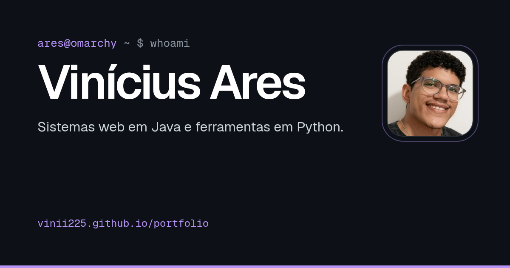

<h1 align="center">Portfólio · Vinícius Ares</h1>

<p align="center">
  Página estática que reúne meus principais projetos, feita com HTML, CSS e JavaScript puros.
</p>

<p align="center">
  <a href="https://vinii225.github.io/portfolio/"><b>vinii225.github.io/portfolio</b></a>
  <br /><br />
  <a href="https://github.com/Vinii225/portfolio/actions/workflows/pipeline.yml"></a>
  
</p>

<p align="center">
  <a href="https://vinii225.github.io/portfolio/"></a>
</p>

## Sobre

O site apresenta quem eu sou, como falar comigo e os projetos que melhor mostram o que eu faço: o **Hackbot**, o **DMT Overlay**, o **AquaFlow** e o **SpendWise**.

- **Sem framework e sem build:** o que está no repositório é o que vai pro ar.
- **Mesma identidade do meu [perfil](https://github.com/Vinii225):** fundo `#0D1117`, lilás `#B794F6` e um visual de terminal.
- **Animações com propósito:** entrada do topo em sequência, reveal ao rolar, nome digitado no navbar e o fluxo de agentes do Hackbot destacado em ordem. Tudo respeita `prefers-reduced-motion`, e a página aparece completa mesmo sem JavaScript.
- **Acessível e leve:** fontes hospedadas no próprio repo, imagens responsivas em WebP, foco visível em todos os links e avisos de nova aba para leitores de tela.

## Estrutura

```text
.
├── index.html                 # conteúdo da página
├── css/style.css              # estilos, tokens de cor e animações
├── js/main.js                 # reveal ao rolar, menu ativo e botão de copiar e-mail
├── assets/
│   ├── avatar-200.jpg         # foto (200 e 400 px)
│   ├── avatar-400.jpg
│   ├── favicon.svg            # ícone da aba (também favicon-32.png e apple-touch-icon.png)
│   ├── og.png                 # prévia ao compartilhar o link
│   ├── fonts/                 # Geist e Geist Mono (woff2)
│   └── projetos/              # prévias dos projetos
├── .htmlhintrc                # regras de validação do HTML
└── .github/workflows/pipeline.yml  # build, test, SAST, DAST e deploy
```

## Rodando localmente

Qualquer servidor estático serve:

```bash
git clone git@github.com:Vinii225/portfolio.git
cd portfolio
python -m http.server 8000
```

Depois é só abrir `http://localhost:8000`.

## Pipeline

A cada push, o workflow [`pipeline.yml`](.github/workflows/pipeline.yml) roda cinco etapas:

1. **SAST:** o [Semgrep](https://semgrep.dev/) analisa o código-fonte com as regras `p/javascript`, `p/xss`, `p/secrets` e `p/github-actions`. Roda em paralelo com o build.
2. **Build:** copia `index.html`, `css/`, `js/` e `assets/` para `dist/`.
3. **Test:** valida o HTML com [htmlhint](https://htmlhint.com/) usando as regras do `.htmlhintrc`.
4. **DAST:** sobe o `dist/` num servidor local e roda o baseline do [OWASP ZAP](https://www.zaproxy.org/) contra o site no ar.
5. **Deploy:** publica no GitHub Pages (só na `main`), e só se o SAST e o DAST passarem.

Validações de segurança:

- **SAST** bloqueia a pipeline se houver achado de severidade `ERROR`; os `WARNING` aparecem no resumo do job.
- **DAST** bloqueia se houver alerta de risco alto; os de risco médio, baixo e informativo aparecem no resumo do job.
- Os relatórios (`semgrep.json`/`.sarif` e `zap.html`/`.json`) ficam salvos como artefatos de cada execução.

## Contato

[vinicius.ares12@gmail.com](mailto:vinicius.ares12@gmail.com) · [LinkedIn](https://www.linkedin.com/in/vinicius-ares) · [GitHub](https://github.com/Vinii225)
